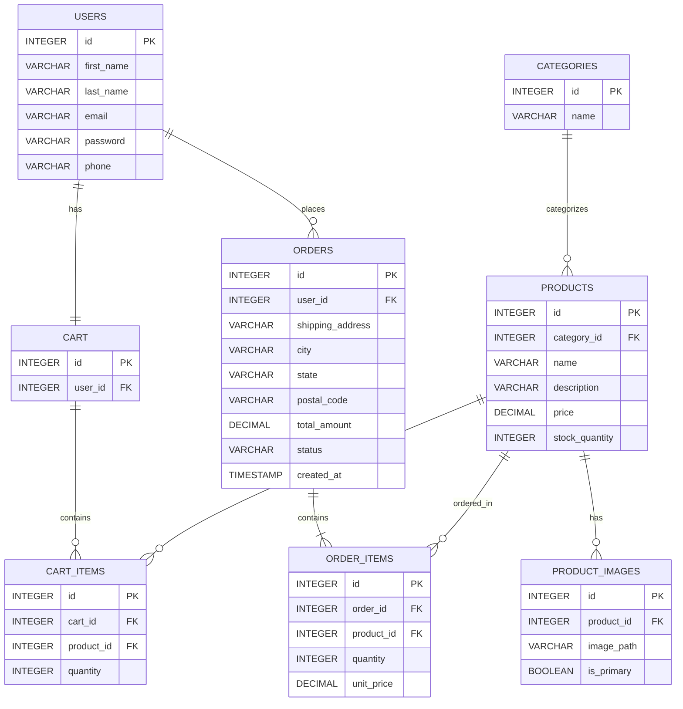

# Sprint 1: System Architecture & Scope Definition

### Project: Online Consumer Electronics Store

---

## Section 1. Target Audience & Market Focus

### Primary Persona

The primary users of the website are customers who purchase consumer electronics online. This includes students, professionals, PC users, and gamers who need electronic products for personal, work, and entertainment purposes.

### Core Pain Point

Customers may need to visit multiple physical and online stores to find and purchase different types of consumer electronics, such as PCs, laptops, consoles, games, and accessories, which can make the shopping process time-consuming and inconvenient. The website addresses this problem by providing a single online platform where customers can find a range of consumer electronics in one place, view product information, and make purchases online.

### Domain Scope

**Vertical Market:** Consumer Electronics

The website will focus on the online sale of laptops, desktop PCs, PC components, monitors, gaming consoles, games/discs, and accessories.

---

## Section 2. Minimum Viable Product (MVP) Feature Scope

The MVP will include the following primary user workflows:

| Category | Feature Name | Description | Priority |
|---|---|---|---|
| Authentication | User Registration & Login | Allows customers to create an account and log in securely using Django's built-in authentication with session-based authentication and password hashing. | High (MVP) |
| Catalog | Product Browsing & Search | Allows customers to browse products, view product images, prices, and details, and search products by name or filter them by category and price. | High (MVP) |
| Cart | Cart Management | Allows customers to add products to the cart, change quantities, and remove items. | High (MVP) |
| Checkout | Order Placement | Allows customers to review their cart, enter shipping details, and place an order using a mock payment gateway. | High (MVP) |
| Admin | Product & Inventory Management | Allows the administrator to perform CRUD operations on products and manage inventory. | Medium |
| Orders | My Orders & Order Status | Allows customers to view their orders and check the current status of each order. | Medium |

---

## Section 3. Tech Stack Selection & Justification

### Frontend Framework: Next.js

**Justification:** Next.js is selected as a full-featured React framework for developing a structured and scalable e-commerce frontend. It supports reusable components, structured routing, image optimization, and server-side rendering when needed, which help organize the application and improve frontend performance. Compared with React alone or Vue.js, Next.js offers additional framework-level features while retaining React’s flexible component-based architecture.

### Backend Infrastructure: Django

**Justification:** Django is selected as the backend framework because it provides a well-established Python-based ecosystem, built-in authentication and security features, database integration through its ORM (Object-Relational Mapper), and an administrative interface for managing products and inventory. Django can support scalable web applications and provides sufficient performance for the expected workload of the e-commerce website. Django REST Framework (DRF) will be used to provide RESTful APIs between the Next.js frontend and Django backend, while Django's built-in features and established ecosystem help reduce development effort compared with lightweight alternatives such as FastAPI or Node.js/Express.

### Database Management System: PostgreSQL

**Justification:** PostgreSQL is selected because the website requires a relational database structure involving users, products, categories, carts, orders, and order items, with clearly defined relationships and foreign-key constraints. Compared with MySQL, PostgreSQL provides strong relational features and data integrity, while compared with non-relational databases such as MongoDB, it provides reliable transaction support and enforcement of relationships between entities, making it well suited for an e-commerce system.

### Caching & Asynchronous Processing (Optional): Redis + Celery

**Justification:** Redis and Celery may be used for background tasks such as processing order confirmation emails without blocking the main order-processing workflow. This provides better responsiveness and task management, but the component is optional and will only be implemented if sufficient time is available during the semester.

---

## Section 4. Entity-Relationship Diagram (ERD)

### Entities

The ERD contains 8 main entities:

* **USERS**: Stores customer account information.
* **CATEGORIES**: Stores product categories.
* **PRODUCTS**: Stores product information.
* **PRODUCT_IMAGES**: Stores multiple images for products.
* **CART**: Stores a customer's shopping cart.
* **CART_ITEMS**: Stores products and quantities inside the cart.
* **ORDERS**: Stores customer order information.
* **ORDER_ITEMS**: Stores individual products and quantities within an order.

### Relationships

* **USERS → CART (1:1):** Each customer has exactly one cart.
* **USERS → ORDERS (1:N):** One customer may place many orders.
* **CATEGORIES → PRODUCTS (1:N):** One category contains many products.
* **PRODUCTS → PRODUCT_IMAGES (1:N):** One product can have many images.
* **ORDERS → ORDER_ITEMS (1:N):** One order contains many items.
* **PRODUCTS → ORDER_ITEMS (1:N):** One product may appear in many order items.
* **CART → CART_ITEMS (1:N):** One cart contains many items.
* **PRODUCTS → CART_ITEMS (1:N):** One product may appear in many cart items.

The **ORDERS ↔ PRODUCTS** relationship is conceptually **N:M** and is implemented through the associative entity **ORDER_ITEMS**. Similarly, the **CART ↔ PRODUCTS** relationship is conceptually **N:M** and is implemented through **CART_ITEMS**.

