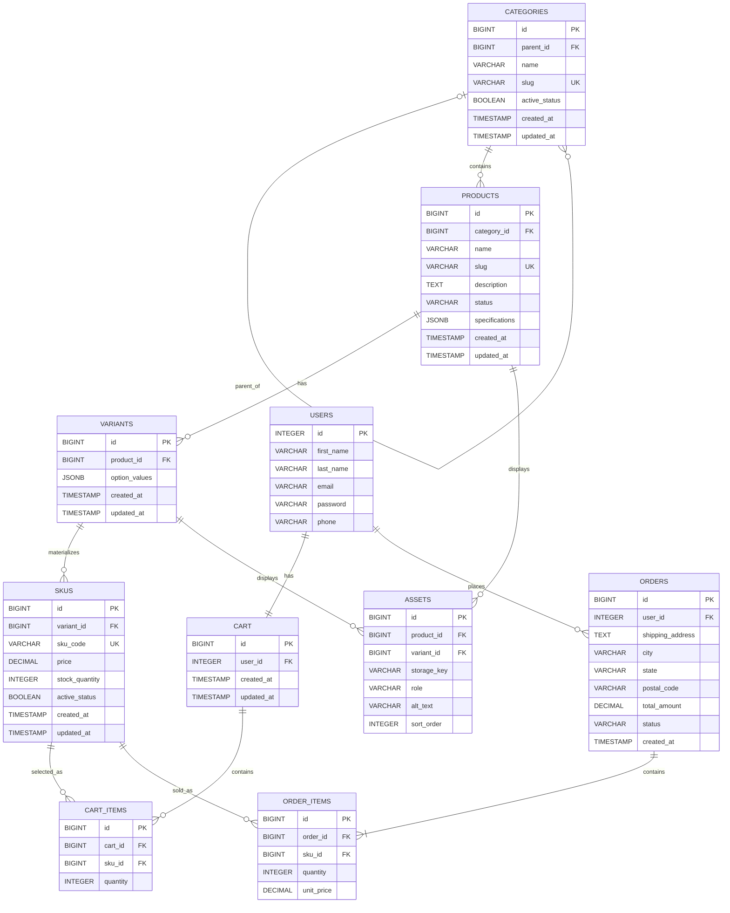

# Sprint 2: Catalog Data Foundation

## 1. Sprint Goal and Scope Boundary

### Sprint Goal

Sprint 2 establishes a reliable database foundation for the e-commerce product catalog. The system persists categories, products, variants, and SKUs while maintaining product identity, relationships, pricing, inventory, and data integrity.

The sprint provides the catalog foundation that can be consumed by the storefront, cart, and checkout functionality in later sprints.

### In Scope

* Category tree management with unique slugs, optional parent categories, and active status.
* Product creation and editing with name, slug, description, status, category, and specifications.
* Product variants with option values.
* SKU management with unique SKU codes, price, stock quantity, and active status.
* Authenticated administrative CRUD operations for categories, products, variants, and SKUs.
* Database constraints and migrations for data integrity.
* Reproducible seed data for demonstration and testing.
* Automated model, validation, and authorization tests.

### Out of Scope

The following functionality is outside the Sprint 2 scope and is planned for Sprint 3 or later:

* Public catalog search and public catalog reads.
* Dynamic specification management beyond the validated JSON structure.
* Asset upload and file storage implementation.
* Publication workflows.
* Payment gateway integration.
* Order placement.
* Shipping integration.
* Complete shopper checkout flow.
---

## 2. Sprint 1 Decisions Reused and Changed

### Decisions Reused from Sprint 1

Sprint 2 continues the business boundary and technology decisions established in Sprint 1.

* The project remains a consumer electronics e-commerce website.
* The catalog remains the foundation for products that will later be used by the cart and checkout functionality.
* PostgreSQL remains the database management system.
* Django and Django REST Framework are used for the backend implementation.
* The Sprint 1 entities for `USERS`, `CARTS`, `CART_ITEMS`, `ORDERS`, and `ORDER_ITEMS` are retained and connected to the Sprint 2 catalog entities.
* The existing category-to-product relationship from Sprint 1 is retained.

### Decisions Changed in Sprint 2

Sprint 2 refines the Sprint 1 product model to represent real catalog inventory more accurately.

* Product price and stock are moved from the product level to the SKU level because different product variants can have different prices and stock quantities.
* The Sprint 1 `PRODUCT_IMAGES` concept is generalized into `ASSETS`, allowing assets to be associated with either a product or a variant.
* Products are extended with variants and SKUs. A variant represents a combination of product options, while a SKU represents a specific sellable inventory record.
* Product specifications are represented as validated JSON data on the Product model.
* The implementation uses Django's built-in `User` model with a separate `UserProfile` model for additional user information such as phone number.
* Cart items and order items reference SKUs rather than products so that the exact inventory item selected or sold can be identified.

These changes extend the Sprint 1 architecture rather than replacing it. Sprint 2 provides the catalog data foundation required for later storefront, cart, and checkout functionality.

---

## 3. Updated ERD and Data Dictionary

### Updated ERD

The Sprint 2 ERD extends the Sprint 1 architecture by adding categories, variants, SKUs, and assets while retaining the existing cart and order entities. Cart items and order items reference SKUs so that the exact sellable inventory item can be identified.




### Data Dictionary

The data dictionary describes the Sprint 2 catalog entities and the Sprint 1 entities that remain connected to the catalog.

### Users

| **Field**    | **Type**              | **Description**                              | **Example**              |
| :----------- | :-------------------- | :------------------------------------------- | :----------------------- |
| `id`         | INTEGER, PK           | Primary key and unique user identifier.      | `1`                      |
| `first_name` | VARCHAR(150)          | User's first name.                           | `Ali`                    |
| `last_name`  | VARCHAR(150)          | User's last name.                            | `Khan`                   |
| `email`      | VARCHAR(254)          | User's email address.                        | `ali@example.com`        |
| `password`   | VARCHAR(128)          | Hashed password used for user authentication. | `hashed_password_value` |
| `phone`      | VARCHAR(20)           | User's phone number.                         | `03001234567`            |

> **Note:** The `USERS` entity is implemented using Django's built-in `User` model. The `phone` field is stored in the separate `UserProfile` model and is represented under `USERS` here to maintain the conceptual structure used in the Sprint 1 ERD.


### Categories

| Field           | Type                  | Description                                 | Example                |
| --------------- | --------------------- | ------------------------------------------- | ---------------------- |
| `id`            | BIGINT, PK           | Primary key and unique category identifier. | `1`                    |
| `parent_id`     | BIGINT, FK, Nullable | Optional reference to a parent category.    | `1`                    |
| `name`          | VARCHAR(255)          | Category name.                              | `Laptops`              |
| `slug`          | VARCHAR(50), UNIQUE   | Unique URL-friendly category identifier.    | `laptops`              |
| `active_status` | BOOLEAN               | Indicates whether the category is active.   | `true`                 |
| `created_at`    | TIMESTAMP             | Category creation time.                     | `2026-09-30T08:35:25Z` |
| `updated_at`    | TIMESTAMP             | Last update time.                           | `2026-09-30T08:35:25Z` |

### Products

| Field            | Type                | Description                                           | Example                                                |
| ---------------- | ------------------- | ----------------------------------------------------- | ------------------------------------------------------ |
| `id`             | BIGINT, PK         | Primary key and unique product identifier.            | `5`                                                    |
| `category_id`    | BIGINT, FK         | Reference to the product's canonical category.        | `8`                                                    |
| `name`           | VARCHAR(255)        | Product name.                                         | `HP Series 3 Pro Monitor`                              |
| `slug`           | VARCHAR(50), UNIQUE | Unique URL-friendly product identifier.               | `hp-series-3-pro-monitor`                              |
| `description`    | TEXT                | Descriptive information about the product.            | `HP Series 3 Pro monitors for everyday office work...` |
| `status`         | VARCHAR(20)         | Product status such as draft, published, or archived. | `draft`                                                |
| `specifications` | JSONB               | Product specifications stored as a JSON object.       | `{"brand": "HP", "resolution": "1920x1080"}`           |
| `created_at`     | TIMESTAMP           | Product creation time.                                | `2026-09-30T09:10:54Z`                                 |
| `updated_at`     | TIMESTAMP           | Last update time.                                     | `2026-09-30T09:10:54Z`                                 |

### Variants

| Field           | Type        | Description                                                          | Example                                              |
| --------------- | ----------- | -------------------------------------------------------------------- | ---------------------------------------------------- |
| `id`            | BIGINT, PK | Primary key and unique variant identifier.                           | `7`                                                  |
| `product_id`    | BIGINT, FK | Reference to the product.                                            | `5`                                                  |
| `option_values` | JSONB       | Variant-specific options such as model, screen size, and panel type. | `{"screen_size": "21.45-inch", "panel_type": "IPS"}` |
| `created_at`    | TIMESTAMP   | Variant creation time.                                               | `2026-09-30T09:12:36Z`                               |
| `updated_at`    | TIMESTAMP   | Last update time.                                                    | `2026-09-30T09:12:36Z`                               |

### SKUs

| Field            | Type                 | Description                                                    | Example                |
| ---------------- | -------------------- | -------------------------------------------------------------- | ---------------------- |
| `id`             | BIGINT, PK          | Primary key and unique SKU record identifier.                  | `7`                    |
| `variant_id`     | BIGINT, FK          | Reference to the variant represented by the SKU.               | `7`                    |
| `sku_code`       | VARCHAR(100), UNIQUE | Unique code identifying the sellable inventory item.           | `HP-322PE-21`          |
| `price`          | DECIMAL(12,2)        | SKU price using decimal representation.                        | `28500.00`             |
| `stock_quantity` | INTEGER              | Available inventory quantity; negative values are not allowed. | `10`                   |
| `active_status`  | BOOLEAN              | Indicates whether the SKU is active.                           | `true`                 |
| `created_at`     | TIMESTAMP            | SKU creation time.                                             | `2026-09-30T09:16:10Z` |
| `updated_at`     | TIMESTAMP            | Last update time.                                              | `2026-09-30T09:16:10Z` |

### Assets

| Field         | Type                  | Description                                   | Example                   |
| ------------- | --------------------- | --------------------------------------------- | ------------------------- |
| `id`          | BIGINT, PK           | Primary key and unique asset identifier.      | `1`                       |
| `product_id`  | BIGINT, FK, Nullable | Optional reference to a product.              | `5`                       |
| `variant_id`  | BIGINT, FK, Nullable | Optional reference to a variant.              | `7`                       |
| `storage_key` | VARCHAR(500)          | Storage identifier or location for the asset. | `products/hp-monitor.jpg` |
| `role`        | VARCHAR(50)           | Defines the purpose of the asset.             | `main`                    |
| `alt_text`    | VARCHAR(255)          | Alternative text describing the asset.        | `HP Series 3 Pro Monitor` |
| `sort_order`  | INTEGER               | Determines the display order of assets.       | `1`                       |

> **Note:** The database constraint requires an asset to belong to exactly one parent: either a product or a variant.

### Cart

| **Field**    | **Type**              | **Description**                              | **Example**              |
| :----------- | :-------------------- | :------------------------------------------- | :----------------------- |
| `id`         | BIGINT, PK           | Primary key and unique cart identifier.      | `1`                      |
| `user_id`    | INTEGER, FK           | References the user who owns the cart.       | `1`                      |
| `created_at` | TIMESTAMP             | Date and time when the cart was created.     | `2026-09-24 10:30:00`    |
| `updated_at` | TIMESTAMP             | Date and time when the cart was last updated.| `2026-09-24 10:45:00`    |

### Cart Items

| **Field** | **Type**              | **Description**                              | **Example**              |
| :-------- | :-------------------- | :------------------------------------------- | :----------------------- |
| `id`      | BIGINT, PK           | Primary key and unique cart item identifier. | `1`                      |
| `cart_id` | BIGINT, FK           | References the cart containing the item.    | `1`                      |
| `sku_id`  | BIGINT, FK           | References the specific SKU selected.       | `5`                      |
| `quantity`| INTEGER               | Number of units of the SKU in the cart.     | `2`                      |

### Orders

| **Field**             | **Type**              | **Description**                                  | **Example**              |
| :-------------------- | :-------------------- | :----------------------------------------------- | :----------------------- |
| `id`                  | BIGINT, PK           | Primary key and unique order identifier.         | `1`                      |
| `user_id`             | INTEGER, FK           | References the user who placed the order.        | `1`                      |
| `shipping_address`    | TEXT                  | Shipping address associated with the order.      | `Main Street, Karachi`   |
| `city`                | VARCHAR(100)          | City of the shipping address.                    | `Karachi`                |
| `state`               | VARCHAR(100)          | State or province of the shipping address.       | `Sindh`                  |
| `postal_code`         | VARCHAR(20)           | Postal code of the shipping address.             | `74000`                  |
| `total_amount`        | DECIMAL(12,2)         | Total monetary amount of the order.              | `150000.00`              |
| `status`              | VARCHAR(50)           | Current status of the order.                     | `pending`                |
| `created_at`          | TIMESTAMP             | Date and time when the order was created.        | `2026-09-24 11:00:00`    |

### Order Items

| **Field**    | **Type**              | **Description**                              | **Example**              |
| :----------- | :-------------------- | :------------------------------------------- | :----------------------- |
| `id`         | BIGINT, PK           | Primary key and unique order item identifier. | `1`                     |
| `order_id`   | BIGINT, FK           | References the order containing the item.    | `1`                     |
| `sku_id`     | BIGINT, FK           | References the specific SKU sold.             | `5`                     |
| `quantity`   | INTEGER               | Number of units ordered.                      | `2`                     |
| `unit_price` | DECIMAL(12,2)         | Price of one unit at the time of the order.  | `75000.00`              |


### Relationship Cardinalities

| Relationship        | Cardinality | Description                                                                                                     |
| ------------------- | ----------- | --------------------------------------------------------------------------------------------------------------- |
| CATEGORIES → CATEGORIES (parent-child self-relationship) | 1 : 0..N         | One category can have zero or many child categories; each category can have at most one parent.                 |
| CATEGORIES → PRODUCTS  | 1 : 0..N         | One category can contain zero or many products; each product belongs to exactly one category.                   |
| PRODUCTS → VARIANTS   | 1 : 0..N        | One product can have zero or many variants; each variant belongs to exactly one product.                        |
| VARIANTS → SKUS       | 1 : 0..N         | One variant can have zero or many SKUs; each SKU belongs to exactly one variant.                                |
| PRODUCTS → ASSETS     | 1 : 0..N         | One product can have zero or many assets. Each asset can belong to either a product or a variant, but not both. |
| VARIANTS → ASSETS     | 1 : 0..N         | One variant can have zero or many assets. Each asset can belong to either a variant or a product, but not both. |
| USERS → CART         | 1:1         | Each user has exactly one cart, and each cart belongs to exactly one user.                                 |
| CART → CART_ITEMS     | 1 : 0..N         | One cart can contain zero or many cart items; each cart item belongs to exactly one cart.                       |
| SKUS → CART_ITEMS      | 1 : 0..N         | One SKU can be referenced by zero or many cart items; each cart item references exactly one SKU.                |
| USERS → ORDERS        | 1 : 0..N         | One user can place zero or many orders; each order belongs to exactly one user.                                 |
| ORDERS → ORDER_ITEMS   | 1 : 1..N         | One order can contain one or many order items; each order item belongs to exactly one order.                   |
| SKUS → ORDER_ITEMS     | 1 : 0..N          | One SKU can be referenced by zero or many order items; each order item references exactly one SKU.              |


### Foreign-Key Delete/Update Policies

The following policies define what happens to related records when a referenced record is deleted or its primary key is updated. Primary key updates are not performed by the application.

| Foreign-Key Relationship   | On Delete | On Update | Reason                                                                                        |
| -------------------------- | --------- | --------- | --------------------------------------------------------------------------------------------- |
| CATEGORIES → CATEGORIES (parent-child self-relationship) | PROTECT | NO ACTION | A parent category cannot be deleted while child categories reference it. . |
| PRODUCTS → CATEGORIES         | PROTECT   | NO ACTION | A category cannot be deleted while products reference it.                                     |
| VARIANTS → PRODUCTS          | CASCADE   | NO ACTION | Deleting a product also deletes its variants.                                                 |
| SKUS → VARIANTS              | PROTECT   | NO ACTION | A variant cannot be deleted while SKUs reference it.                                          |
| ASSETS → PRODUCTS            | CASCADE   | NO ACTION | Deleting a product deletes its associated assets.                                             |
| ASSETS → VARIANTS            | CASCADE   | NO ACTION | Deleting a variant deletes its associated assets.                                             |                                          |
| CART → USERS                | CASCADE   | NO ACTION | Deleting a user also deletes the associated cart.                                             |
| CART_ITEMS → CART            | CASCADE   | NO ACTION | Deleting a cart also deletes its cart items.                                                  |
| CART_ITEMS → SKUS             | PROTECT   | NO ACTION | A SKU cannot be deleted while cart items reference it.                                        |
| ORDERS → USERS               | PROTECT   | NO ACTION | A user cannot be deleted while orders reference that user.                                    |
| ORDER_ITEMS → ORDERS          | CASCADE   | NO ACTION | Deleting an order also deletes its order items.                                               |
| ORDER_ITEMS → SKUS            | PROTECT   | NO ACTION | A SKU cannot be deleted while order items reference it.                                       |

**Update policy:** Foreign-key references use the database's default `NO ACTION` behavior for referenced primary-key updates. The application does not provide a feature for changing primary keys. These policies preserve referential integrity and protect inventory records referenced by carts or orders.

---
## 4. Administration Route Table

All catalog administration endpoints require an authenticated Django admin user. Unauthorized users are rejected by the `IsAdminUser` permission.

| Resource   | Endpoint                         | Methods                 | Purpose                                                   |
| ---------- | -------------------------------- | ----------------------- | --------------------------------------------------------- |
| Categories | `/api/v1/admin/categories/`      | GET, POST               | List categories or create a category.                     |
| Category   | `/api/v1/admin/categories/<id>/` | GET, PUT, PATCH, DELETE | Retrieve, update, partially update, or delete a category. |
| Products   | `/api/v1/admin/products/`        | GET, POST               | List products or create a product.                        |
| Product    | `/api/v1/admin/products/<id>/`   | GET, PUT, PATCH, DELETE | Retrieve, update, partially update, or delete a product.  |
| Variants   | `/api/v1/admin/variants/`        | GET, POST               | List variants or create a variant.                        |
| Variant    | `/api/v1/admin/variants/<id>/`   | GET, PUT, PATCH, DELETE | Retrieve, update, partially update, or delete a variant.  |
| SKUs       | `/api/v1/admin/skus/`            | GET               | List all SKUs.                          |
| SKU        | `/api/v1/admin/skus/<id>/`       | GET, PUT, PATCH, DELETE | Retrieve, update, partially update, or delete a SKU.      |
|Product SKUs  | `/api/v1/admin/products/<id>/skus/`       | GET, POST | List or create SKUs for a specific product.     |

## Authentication and Authorization

All routes use Django REST Framework's `IsAdminUser` permission. Therefore, catalog management operations are restricted to authenticated users with admin/staff privileges.

## Example Administration Flow

An administrator can use the API to:

1. Create a category using `POST /api/v1/admin/categories/`.
2. Create a product using `POST /api/v1/admin/products/`.
3. Create a variant using `POST /api/v1/admin/variants/`.
4. Create a SKU using `POST /api/v1/admin/products/<id>/skus/`.
5. Retrieve the created records using the corresponding `GET` endpoints.
6. Update or deactivate records using `PATCH` on the corresponding detail endpoint.

## Endpoint Details

### 4.1 Create a Product

**Endpoint:** `POST /api/v1/admin/products/`

**Purpose:** Create a draft product.

**Authentication:** Authenticated administrator only.

**Request fields:**
- `category` — required category ID.
- `name` — required product name.
- `slug` — required and unique product slug.
- `description` — optional product description.
- `status` — optional product status; defaults to `draft`.
- `specifications` — optional JSON object.

**Response Shape:** Returns the created product record, including its ID, category, name, slug, description, status, specifications, and timestamps.

**Status codes:**
- `201 Created`: product created successfully.
- `400 Bad Request`: validation error.
- `403 Forbidden`: user is not authorized as an administrator.

**Validation errors:**

* Duplicate `slug` returns a client validation error.

  **Example validation response:**

  ```text
  POST /api/v1/admin/products/
  ```

  ```text
  HTTP 400 Bad Request
  Allow: GET, POST, HEAD, OPTIONS
  Content-Type: application/json
  Vary: Accept
  ```

  ```json
  {
      "slug": [
          "product with this slug already exists."
      ]
  }
  ```

* Invalid `specifications` value returns a validation error because specifications must be a JSON object.

  **Example validation response:**

  ```text
  POST /api/v1/admin/products/
  ```

  ```text
  HTTP 400 Bad Request
  Allow: GET, POST, HEAD, OPTIONS
  Content-Type: application/json
  Vary: Accept
  ```

  ```json
  {
      "specifications": [
          "Specifications must be a JSON object."
      ]
  }
  ```
---
#### Example Request

`POST /api/v1/admin/products/`

```json
{
  "category": 1,
  "name": "Dell Inspiron 15",
  "slug": "dell-inspiron-15",
  "description": "Dell Inspiron 15 laptop for everyday use.",
  "status": "draft",
  "specifications": {
    "brand": "Dell",
    "processor": "Intel Core i5",
    "ram": "16GB"
  }
}
```
#### Example Response

`201 Created`

```json
{
  "id": 10,
  "category": 1,
  "name": "Dell Inspiron 15",
  "slug": "dell-inspiron-15",
  "description": "Dell Inspiron 15 laptop for everyday use.",
  "status": "draft",
  "specifications": {
    "brand": "Dell",
    "processor": "Intel Core i5",
    "ram": "16GB"
  },
  "created_at": "2026-10-01T10:30:00Z",
  "updated_at": "2026-10-01T10:30:00Z"
}
```
---
### 4.2 Update a Product

**Endpoint:** `PATCH /api/v1/admin/products/<id>/`

**Purpose:** Update product content or status.

**Authentication:** Authenticated administrator only.

**Request fields:**

* `category` — optional category ID.
* `name` — optional product name.
* `slug` — optional and unique product slug.
* `description` — optional product description.
* `status` — optional product status.
* `specifications` — optional JSON object.

**Response Shape:** Returns the updated product record, including its ID, category, name, slug, description, status, specifications, and timestamps.

**Status codes:**

* `200 OK`: product updated successfully.
* `400 Bad Request`: validation error.
* `403 Forbidden`: user is not authorized as an administrator.
* `404 Not Found`: product does not exist.

**Validation errors:**

* Duplicate `slug` returns a client validation error.
* Invalid `specifications` value returns a validation error because specifications must be a JSON object.

---
#### Example Request

`PATCH /api/v1/admin/products/10/`

```json
{
  "status": "published",
  "description": "Dell Inspiron 15 laptop with Intel Core i5 processor and 16GB RAM."
}
```

#### Example Response

`200 OK`

```json
{
  "id": 10,
  "category": 1,
  "name": "Dell Inspiron 15",
  "slug": "dell-inspiron-15",
  "description": "Dell Inspiron 15 laptop with Intel Core i5 processor and 16GB RAM.",
  "status": "published",
  "specifications": {
    "brand": "Dell",
    "processor": "Intel Core i5",
    "ram": "16GB"
  },
  "created_at": "2026-10-01T10:30:00Z",
  "updated_at": "2026-10-01T10:45:00Z"
}
```
---

### 4.3 Add a SKU to a Product

**Endpoint:** `POST /api/v1/admin/products/<id>/skus/`

**Purpose:** Add a validated SKU to a specific product.

**Authentication:** Authenticated administrator only.

**Request fields:**

* `variant` — required variant ID belonging to the specified product.
* `sku_code` — required and unique SKU code.
* `price` — required SKU price; must not be negative.
* `stock_quantity` — optional stock quantity; must not be negative.
* `active_status` — optional active status; defaults to `true`.

**Response Shape:** Returns the created SKU record, including its ID, variant, SKU code, price, stock quantity, active status, and timestamps.

**Status codes:**

* `201 Created`: SKU created successfully.
* `400 Bad Request`: validation error.
* `403 Forbidden`: user is not authorized as an administrator.
* `404 Not Found`: product or variant does not exist.

**Validation errors:**

* Duplicate `sku_code` returns a client validation error.

  **Example validation response:**

  ```text
  POST /api/v1/admin/products/5/skus/
  ```

  ```text
    HTTP 400 Bad Request
    Allow: GET, POST, HEAD, OPTIONS
    Content-Type: application/json
    Vary: Accept
  ```

  ```json
  {
      "sku_code": [
          "sku with this sku code already exists."
      ]
  }
  ```

* Negative `price` or `stock_quantity` returns a validation error.

  **Example validation response:**

  ```text
  POST /api/v1/admin/products/5/skus/
  ```

  ```text
  HTTP 400 Bad Request
  Allow: GET, POST, HEAD, OPTIONS
  Content-Type: application/json
  Vary: Accept
  ```

  ```json
  {
      "price": [
          "Price cannot be negative."
      ],
      "stock_quantity": [
          "Stock quantity cannot be negative."
      ]
  }
  ```

* A variant that does not belong to the specified product is rejected.

  **Example validation response:**

  ```text
  POST /api/v1/admin/products/5/skus/
  ```

  ```text
  HTTP 404 Not Found
  Allow: GET, POST, HEAD, OPTIONS
  Content-Type: application/json
  Vary: Accept
  ```

  ```json
  {
      "detail": "No Variant matches the given query."
  }
  ```

---


#### Example Request

`POST /api/v1/admin/products/10/skus/`

```json
{
  "variant": 12,
  "sku_code": "DELL-INSP15-BLK-16",
  "price": "145000.00",
  "stock_quantity": 10,
  "active_status": true
}
```

#### Example Response

`201 Created`

```json
{
  "id": 12,
  "variant": 12,
  "sku_code": "DELL-INSP15-BLK-16",
  "price": "145000.00",
  "stock_quantity": 10,
  "active_status": true,
  "created_at": "2026-10-01T10:35:00Z",
  "updated_at": "2026-10-01T10:35:00Z"
}
```
---

### 4.4 Update a SKU

**Endpoint:** `PATCH /api/v1/admin/skus/<id>/`

**Purpose:** Update the price, stock quantity, or active status of a SKU.

**Authentication:** Authenticated administrator only.

**Request fields:**

* `price` — optional SKU price; must not be negative.
* `stock_quantity` — optional stock quantity; must not be negative.
* `active_status` — optional active status.

**Response Shape:** Returns the updated SKU record, including its ID, variant, SKU code, price, stock quantity, active status, and timestamps.

**Status codes:**

* `200 OK`: SKU updated successfully.
* `400 Bad Request`: validation error.
* `403 Forbidden`: user is not authorized as an administrator.
* `404 Not Found`: SKU does not exist.

**Validation errors:**

* Negative `price` returns a validation error.
* Negative `stock_quantity` returns a validation error.

---
#### Example Request

`PATCH /api/v1/admin/skus/12/`

```json
{
  "price": "147000.00",
  "stock_quantity": 8,
  "active_status": true
}
```

#### Example Response

`200 OK`

```json
{
  "id": 12,
  "variant": 12,
  "sku_code": "DELL-INSP15-BLK-16",
  "price": "147000.00",
  "stock_quantity": 8,
  "active_status": true,
  "created_at": "2026-10-01T10:35:00Z",
  "updated_at": "2026-10-01T10:50:00Z"
}
```

---

### 4.5 List Administrative Products

**Endpoint:** `GET /api/v1/admin/products/`

**Purpose:** Return administrative product records.

**Authentication:** Authenticated administrator only.

**Request fields:** None.

**Response Shape:** Returns a list of product records, including each product's ID, category, name, slug, description, status, specifications, and timestamps.

**Status codes:**

* `200 OK`: product records returned successfully.
* `403 Forbidden`: user is not authorized as an administrator.

**Validation errors:** Not applicable because this endpoint does not accept request data.

---
#### Example Request

`GET /api/v1/admin/products/`

#### Example Response

`200 OK`

```json
[
  {
    "id": 10,
    "category": 1,
    "name": "Dell Inspiron 15",
    "slug": "dell-inspiron-15",
    "description": "Dell Inspiron 15 laptop for everyday use.",
    "status": "published",
    "specifications": {
      "brand": "Dell",
      "processor": "Intel Core i5",
      "ram": "16GB"
    },
    "created_at": "2026-10-02T10:30:00Z",
    "updated_at": "2026-10-02T10:45:00Z"
  }
]
```
---

### 4.6 Create a Category

**Endpoint:** `POST /api/v1/admin/categories/`

**Purpose:** Create a category in the catalog.

**Authentication:** Authenticated administrator only.

**Request fields:**

* `name` — required category name.
* `slug` — required and unique category slug.
* `parent` — optional parent category ID.
* `active_status` — optional category status; defaults to `true`.

**Response Shape:** Returns the created category record, including its ID, parent, name, slug, active status, and timestamps.

**Status codes:**

* `201 Created`: category created successfully.
* `400 Bad Request`: validation error.
* `403 Forbidden`: user is not authorized as an administrator.


**Validation errors:**

* Duplicate `slug` returns a client validation error.

* A category cannot be its own parent.

  **Example validation response:**

  ```text
  PUT /api/v1/admin/categories/8/
  ```

  ```text
  HTTP 400 Bad Request
  Allow: GET, PUT, PATCH, DELETE, HEAD, OPTIONS
  Content-Type: application/json
  Vary: Accept
  ```

  ```json
  {
      "parent": [
          "A category cannot be its own parent."
      ]
  }
  ```

* A category cannot become its own ancestor.

  **Example validation response:**

  ```text
  PUT /api/v1/admin/categories/1/
  ```

  ```text
  HTTP 400 Bad Request
  Allow: GET, PUT, PATCH, DELETE, HEAD, OPTIONS
  Content-Type: application/json
  Vary: Accept
  ```

  ```json
  {
      "parent": [
          "A category cannot become its own ancestor."
      ]
  }
  ```
---

#### Example Request

`POST /api/v1/admin/categories/`

```json
{
  "name": "Laptops",
  "slug": "laptops",
  "parent": null,
  "active_status": true
}
```

#### Example Response

`201 Created`

```json
{
  "id": 1,
  "parent": null,
  "name": "Laptops",
  "slug": "laptops",
  "active_status": true,
  "created_at": "2026-10-01T10:20:00Z",
  "updated_at": "2026-10-01T10:20:00Z"
}
```
---
### 4.7 List Categories

**Endpoint:** `GET /api/v1/admin/categories/`

**Purpose:** Return the category records used to manage the catalog category tree.

**Authentication:** Authenticated administrator only.

**Request fields:** None.

**Response Shape:** Returns a list of category records, including each category's ID, parent, name, slug, active status, and timestamps.

**Status codes:**

* `200 OK`: category records returned successfully.
* `403 Forbidden`: user is not authorized as an administrator.

**Validation errors:** Not applicable because this endpoint does not accept request data.

---
#### Example Request

`GET /api/v1/admin/categories/`

#### Example Response

`200 OK`

```json
[
  {
    "id": 1,
    "parent": null,
    "name": "Laptops",
    "slug": "laptops",
    "active_status": true,
    "created_at": "2026-10-01T10:20:00Z",
    "updated_at": "2026-10-01T10:20:00Z"
  },
  {
    "id": 2,
    "parent": 1,
    "name": "Dell",
    "slug": "dell",
    "active_status": true,
    "created_at": "2026-10-01T10:22:00Z",
    "updated_at": "2026-10-01T10:22:00Z"
  }
]
```

---
### 4.8 Create a Variant

**Endpoint:** `POST /api/v1/admin/variants/`

**Purpose:** Create a product variant with specific option values.

**Authentication:** Authenticated administrator only.

**Request fields:**

* `product` — required product ID.
* `option_values` — required JSON object containing variant options.

**Response Shape:** Returns the created variant record, including ID, product, option values, and timestamps.

**Status codes:**

* `201 Created`
* `400 Bad Request`
* `403 Forbidden`

**Validation errors:**

* Invalid or missing product.
* `option_values` must be a valid JSON object.
* Duplicate variant option combination for the same product.

---
#### Example Request

`POST /api/v1/admin/variants/`

```json
{
  "product": 10,
  "option_values": {
    "color": "Black",
    "ram": "16GB"
  }
}
```

#### Example Response

`201 Created`

```json
{
  "id": 12,
  "product": 10,
  "option_values": {
    "color": "Black",
    "ram": "16GB"
  },
  "created_at": "2026-10-01T10:32:00Z",
  "updated_at": "2026-10-01T10:32:00Z"
}
```

---
### 4.9 Update a Variant

**Endpoint:** `PATCH /api/v1/admin/variants/<id>/`

**Purpose:** Update the option values or product association of an existing variant.

**Authentication:** Authenticated administrator only.

**Request fields:**

* `product` — optional product ID.
* `option_values` — optional JSON object containing variant options.

**Response Shape:** Returns the updated variant record, including ID, product, option values, and timestamps.

**Status codes:**

* `200 OK`
* `400 Bad Request`
* `403 Forbidden`
* `404 Not Found`

**Validation errors:**

* Invalid or missing product.
* Invalid `option_values` data.
* Duplicate variant option combination for the same product.

---
#### Example Request

`PATCH /api/v1/admin/variants/12/`

```json
{
  "option_values": {
    "color": "Silver",
    "ram": "16GB"
  }
}
```

#### Example Response

`200 OK`

```json
{
  "id": 12,
  "product": 10,
  "option_values": {
    "color": "Silver",
    "ram": "16GB"
  },
  "created_at": "2026-10-02T10:32:00Z",
  "updated_at": "2026-10-02T10:55:00Z"
}
```
---
## 5. Data Integrity and Authorization Decisions

### 5.1 Data Integrity Decisions

The catalog API applies validation rules to maintain accurate and consistent product data.

* **Unique product slugs:** Each product must have a unique slug.
* **Unique category slugs:** Each category must have a unique slug.
* **Unique SKU codes:** Each SKU must have a unique SKU code.
* **Valid category hierarchy:** A category cannot be its own parent or create a circular parent relationship.
* **Valid variant combinations:** The same option combination cannot be repeated for the same product.
* **Non-negative price:** SKU price cannot be negative.
* **Non-negative stock:** SKU stock quantity cannot be negative.
* **Valid product-variant relationship:** A variant must belong to the specified product when creating a product-specific SKU.
* **Product status control:** Products use controlled statuses such as `draft`, `published`, and `archived`.

### 5.2 Authorization Decisions

All catalog administration endpoints are protected using Django REST Framework's `IsAdminUser` permission.

Only authenticated users with administrator/staff privileges can perform catalog management operations such as:

* Creating and updating categories.
* Creating and updating products.
* Creating and updating variants.
* Creating and updating SKUs.
* Viewing administrative catalog records.

Unauthenticated users are denied access to these administration endpoints.

**Example response for unauthenticated access:**

```text
GET /api/v1/admin/variants/
```

```text
HTTP 403 Forbidden
Allow: GET, POST, HEAD, OPTIONS
Content-Type: application/json
Vary: Accept
```

```json
{
    "detail": "Authentication credentials were not provided."
}
```


### 5.3 Business Rules and Edge Cases

#### 1. Can a draft product have no SKU? Can a published product have no sellable SKU?

A draft product can exist without a SKU because products and SKUs are managed as separate records. This allows an administrator to create the product first and add variants and SKUs later.

A published product must have at least one **active SKU with available stock**. The product cannot be changed to `published` if it does not have a sellable SKU.

**Implementation example:** A product is first created with status `draft` without any SKU. After an active SKU with available stock is added, the product can be changed to `published`. If an administrator tries to publish a product without a sellable SKU, the request is rejected with a validation error.

#### 2. Is a product assigned to one canonical category, many categories, or both? Why?

Each product is assigned to **one category** through the `category` foreign key in the Product model. This provides a clear canonical category for each product and keeps the catalog structure simple for the MVP.

**Implementation example:** The `Motherboards` is assigned to the `PC Components` category.

#### 3. What happens when a parent category is deactivated?

Deactivating a category does not automatically deactivate its child categories. The `active_status` field is stored on the category itself, so each category's active state can be managed independently.

**Implementation example:** If a parent category is changed to `active_status = false`, its child category records remain stored and their own `active_status` values are unchanged.

**Planned enhancement:** In a later sprint, category management may be enhanced so that deactivating a parent category also deactivates its child categories.

#### 4. How is an out-of-stock SKU represented in a public response?

An out-of-stock SKU is represented by its `stock_quantity` being `0`. The SKU can remain active, but the zero stock quantity indicates that the item is currently unavailable for purchase.

**Implementation example:** A SKU with `"stock_quantity": 0` represents an out-of-stock SKU.

#### 5. Can two SKUs share a price? Can a SKU have a price override?

Two different SKUs can have the same price because price uniqueness is not required. Each SKU has its own `price`    field, allowing different SKUs to have different selling prices. There is no separate price override concept because the SKU price is the only selling price defined in the current data model.

**Implementation example:** Two different SKU records may both have a price of `28500.00`, while another SKU for the same product can have a different price.

#### 6. What prevents negative stock and duplicate SKU codes?

Negative stock is prevented through serializer validation and the database constraint on `stock_quantity`. Duplicate SKU codes are prevented because `sku_code` is unique.

**Implementation example:** An attempt to create a SKU with negative stock or an already-used SKU code is rejected with a client validation error instead of creating invalid data.

#### 7. What happens to a product referenced by a future cart or order after it is deactivated?

Product deactivation is represented by changing the product status rather than deleting the product record. This preserves the product and its relationships for existing or future business records.

**Implementation example:** A product can be changed from `published` to `archived`, while its product record and related SKU records remain stored.

---
## 6. Seed-Data and Demonstration Instructions

### 6.1 Seed Data

The repository includes reproducible seed data for the Sprint 2 catalog. The seed data demonstrates category hierarchy, products, variants, SKUs, prices, stock quantities, and an unavailable variant combination.

#### Category Hierarchy

The seed data includes multiple category levels. For example:

* **Laptops**

  * Dell
  * HP
  * Lenovo
* **PC Components**

  * RAM
  * Graphics Cards

This demonstrates the required parent-child category hierarchy.

#### Products

The seed data includes the following products:

* **Dell Inspiron 15**
* **HP Victus 15**
* **Corsair Vengeance 16GB**
* **NVIDIA GeForce RTX 4060**

The **Dell Inspiron 15** product demonstrates multiple variants.

#### Variants and SKUs

The Dell Inspiron 15 has multiple valid variants and SKUs:

| Variant      | SKU                |     Price | Stock |
| ------------ | ------------------ | --------: | ----: |
| Black, 16GB  | `DELL-INSP-BLK-16` | 145000.00 |    10 |
| Silver, 16GB | `DELL-INSP-SLV-16` | 147000.00 |     8 |
| Black, 32GB  | `DELL-INSP-BLK-32` | 160000.00 |     5 |

Other valid SKU examples include:

* `HP-VICTUS15-SLV-16` — Silver, 16GB — stock 7
* `CORSAIR-VEN-16` — 16GB — stock 20
* `NVIDIA-RTX4060-8GB` — 8GB — stock 6

#### Unavailable Variant Combination

For **Dell Inspiron 15**, the combination **Silver + 32GB** is intentionally unavailable. No variant/SKU is created for this combination.

This demonstrates that a missing variant combination is not represented as a fake or zero-stock SKU.

---
### 6.2 Demonstration Instructions

The administration API demonstration shows the workflow used by an authenticated administrator to create and retrieve catalog records. The demonstration covers category creation, product creation, variant creation, SKU creation, and retrieval of the created records.

> **Note:** The records in this demonstration were created using the **Django REST Framework Browsable API HTML form**. Therefore, the submitted values are shown as **Submitted Form Data** rather than as JSON request bodies. The JSON shown in each response is the actual API response returned after the form submission.

#### Demonstration 1 — Create Category

**Request**

```text
POST /api/v1/admin/categories/
```

**Submitted Form Data**

```text
parent:
name: Monitors
slug: monitors
active_status: true
```

**Response — 201 Created**

```text
HTTP 201 Created
Allow: GET, POST, HEAD, OPTIONS
Content-Type: application/json
Vary: Accept
```

```json
{
    "id": 8,
    "parent": null,
    "name": "Monitors",
    "slug": "monitors",
    "active_status": true,
    "created_at": "2026-09-30T08:35:25.761523Z",
    "updated_at": "2026-09-30T08:35:25.761538Z"
}
```

The response confirms that the **Monitors** category was successfully created.

#### Demonstration 2 — Create Product

**Request**

```text
POST /api/v1/admin/products/
```

**Submitted Form Data**

```text
category: 8
name: HP Series 3 Pro Monitor
slug: hp-series-3-pro-monitor
description: HP Series 3 Pro monitors for everyday office work, productivity, browsing, and general multimedia use, available in different screen sizes and configurations.
status: draft
specifications:
{
    "brand": "HP",
    "resolution": "1920x1080",
    "refresh_rate": "100Hz",
    "warranty": "Official Warranty"
}
```

**Response — 201 Created**

```text
HTTP 201 Created
Allow: GET, POST, HEAD, OPTIONS
Content-Type: application/json
Vary: Accept
```

```json
{
    "id": 5,
    "category": 8,
    "name": "HP Series 3 Pro Monitor",
    "slug": "hp-series-3-pro-monitor",
    "description": "HP Series 3 Pro monitors for everyday office work, productivity, browsing, and general multimedia use, available in different screen sizes and configurations.",
    "status": "draft",
    "specifications": {
        "brand": "HP",
        "resolution": "1920x1080",
        "refresh_rate": "100Hz",
        "warranty": "Official Warranty"
    },
    "created_at": "2026-09-30T09:10:54.211599Z",
    "updated_at": "2026-09-30T09:10:54.211612Z"
}
```

The response confirms that the product was successfully created and assigned to category `8`.

#### Demonstration 3 — Create Product Variant

**Request**

```text
POST /api/v1/admin/variants/
```

**Submitted Form Data**

```text
product: 5
option_values:
{
    "model": "HP Series 3 Pro 322pe",
    "screen_size": "21.45-inch",
    "panel_type": "IPS",
    "refresh_rate": "100Hz"
}
```

**Response — 201 Created**

```text
HTTP 201 Created
Allow: GET, POST, HEAD, OPTIONS
Content-Type: application/json
Vary: Accept
```

```json
{
    "id": 7,
    "product": 5,
    "option_values": {
        "model": "HP Series 3 Pro 322pe",
        "screen_size": "21.45-inch",
        "panel_type": "IPS",
        "refresh_rate": "100Hz"
    },
    "created_at": "2026-09-30T09:12:36.001063Z",
    "updated_at": "2026-09-30T09:12:36.001077Z"
}
```

The response confirms that the variant was successfully created and associated with product `5`.

#### Demonstration 4 — Create Second Product Variant

**Request**

```text
POST /api/v1/admin/variants/
```

**Submitted Form Data**

```text
product: 5
option_values:
{
    "model": "HP Series 3 Pro 324pv",
    "screen_size": "23.8-inch",
    "panel_type": "VA",
    "refresh_rate": "100Hz"
}
```

**Response — 201 Created**

```text
HTTP 201 Created
Allow: GET, POST, HEAD, OPTIONS
Content-Type: application/json
Vary: Accept
```

```json
{
    "id": 8,
    "product": 5,
    "option_values": {
        "model": "HP Series 3 Pro 324pv",
        "screen_size": "23.8-inch",
        "panel_type": "VA",
        "refresh_rate": "100Hz"
    },
    "created_at": "2026-09-30T09:13:45.532707Z",
    "updated_at": "2026-09-30T09:13:45.532720Z"
}
```

The response confirms that the second variant was successfully created for product `5`.

#### Demonstration 5 — Create SKU

**Request**

```text
POST /api/v1/admin/products/5/skus/
```

**Submitted Form Data**

```text
variant: 7
sku_code: HP-322PE-21
price: 28500.00
stock_quantity: 10
active_status: true
```

**Response — 201 Created**

```text
HTTP 201 Created
Allow: GET, POST, HEAD, OPTIONS
Content-Type: application/json
Vary: Accept
```

```json
{
    "id": 7,
    "variant": 7,
    "sku_code": "HP-322PE-21",
    "price": "28500.00",
    "stock_quantity": 10,
    "active_status": true,
    "created_at": "2026-09-30T09:16:10.317933Z",
    "updated_at": "2026-09-30T09:16:10.317946Z"
}
```

The response confirms that the SKU was successfully created for variant `7`.

#### Demonstration 6 — Create Second SKU

**Request**

```text
POST /api/v1/admin/products/5/skus/
```

**Submitted Form Data**

```text
variant: 8
sku_code: HP-324PV-24
price: 35500.00
stock_quantity: 8
active_status: true
```

**Response — 201 Created**

```text
HTTP 201 Created
Allow: GET, POST, HEAD, OPTIONS
Content-Type: application/json
Vary: Accept
```

```json
{
    "id": 8,
    "variant": 8,
    "sku_code": "HP-324PV-24",
    "price": "35500.00",
    "stock_quantity": 8,
    "active_status": true,
    "created_at": "2026-09-30T09:17:14.073135Z",
    "updated_at": "2026-09-30T09:17:14.073147Z"
}
```

The response confirms that the second SKU was successfully created for variant `8`.

#### Demonstration 7 — Retrieve Created Category

**Request**

```text
GET /api/v1/admin/categories/8/
```

**Response — 200 OK**

```text
HTTP 200 OK
Allow: GET, PUT, PATCH, DELETE, HEAD, OPTIONS
Content-Type: application/json
Vary: Accept
```

```json
{
    "id": 8,
    "parent": null,
    "name": "Monitors",
    "slug": "monitors",
    "active_status": true,
    "created_at": "2026-09-30T08:35:25.761523Z",
    "updated_at": "2026-09-30T08:35:25.761538Z"
}
```

The response confirms that the created category can be retrieved successfully through the administration API.

#### Demonstration 8 — Retrieve Created Product

**Request**

```text
GET /api/v1/admin/products/5/
```

**Response — 200 OK**

```text
HTTP 200 OK
Allow: GET, PUT, PATCH, DELETE, HEAD, OPTIONS
Content-Type: application/json
Vary: Accept
```

```json
{
    "id": 5,
    "category": 8,
    "name": "HP Series 3 Pro Monitor",
    "slug": "hp-series-3-pro-monitor",
    "description": "HP Series 3 Pro monitors for everyday office work, productivity, browsing, and general multimedia use, available in different screen sizes and configurations.",
    "status": "draft",
    "specifications": {
        "brand": "HP",
        "warranty": "Official Warranty",
        "resolution": "1920x1080",
        "refresh_rate": "100Hz"
    },
    "created_at": "2026-09-30T09:10:54.211599Z",
    "updated_at": "2026-09-30T09:10:54.211612Z"
}
```

The response confirms that the created product and its category relationship can be retrieved successfully.

#### Demonstration 9 — Retrieve Variants

**Request**

```text
GET /api/v1/admin/variants/
```

**Response — 200 OK**

```text
HTTP 200 OK
Allow: GET, POST, HEAD, OPTIONS
Content-Type: application/json
Vary: Accept
```

The response confirms that variants `7` and `8` are stored and associated with product `5`.

```json
[
    {
        "id": 1,
        "product": 1,
        "option_values": {
            "ram": "16GB",
            "color": "Black"
        },
        "created_at": "2026-09-30T08:28:15.338903Z",
        "updated_at": "2026-09-30T08:28:15.338915Z"
    },
    {
        "id": 2,
        "product": 1,
        "option_values": {
            "ram": "16GB",
            "color": "Silver"
        },
        "created_at": "2026-09-30T08:28:15.341585Z",
        "updated_at": "2026-09-30T08:28:15.341598Z"
    },
    {
        "id": 3,
        "product": 1,
        "option_values": {
            "ram": "32GB",
            "color": "Black"
        },
        "created_at": "2026-09-30T08:28:15.343901Z",
        "updated_at": "2026-09-30T08:28:15.343914Z"
    },
    {
        "id": 4,
        "product": 2,
        "option_values": {
            "ram": "16GB",
            "color": "Silver"
        },
        "created_at": "2026-09-30T08:28:15.376228Z",
        "updated_at": "2026-09-30T08:28:15.376239Z"
    },
    {
        "id": 5,
        "product": 3,
        "option_values": {
            "capacity": "16GB"
        },
        "created_at": "2026-09-30T08:28:15.382791Z",
        "updated_at": "2026-09-30T08:28:15.382804Z"
    },
    {
        "id": 6,
        "product": 4,
        "option_values": {
            "memory": "8GB"
        },
        "created_at": "2026-09-30T08:28:15.389633Z",
        "updated_at": "2026-09-30T08:28:15.389646Z"
    },
    {
        "id": 7,
        "product": 5,
        "option_values": {
            "model": "HP Series 3 Pro 322pe",
            "panel_type": "IPS",
            "screen_size": "21.45-inch",
            "refresh_rate": "100Hz"
        },
        "created_at": "2026-09-30T09:12:36.001063Z",
        "updated_at": "2026-09-30T09:12:36.001077Z"
    },
    {
        "id": 8,
        "product": 5,
        "option_values": {
            "model": "HP Series 3 Pro 324pv",
            "panel_type": "VA",
            "screen_size": "23.8-inch",
            "refresh_rate": "100Hz"
        },
        "created_at": "2026-09-30T09:13:45.532707Z",
        "updated_at": "2026-09-30T09:13:45.532720Z"
    }
]
```

#### Demonstration 10 — Retrieve SKUs

**Request**

```text
GET /api/v1/admin/skus/
```

**Response — 200 OK**

```text
HTTP 200 OK
Allow: GET, HEAD, OPTIONS
Content-Type: application/json
Vary: Accept
```

The response confirms that the created SKUs are stored with their associated variants, prices, and stock quantities.

```json
[
    {
        "id": 1,
        "variant": 1,
        "sku_code": "DELL-INSP-BLK-16",
        "price": "145000.00",
        "stock_quantity": 10,
        "active_status": true,
        "created_at": "2026-09-30T08:28:15.351984Z",
        "updated_at": "2026-09-30T08:28:15.352001Z"
    },
    {
        "id": 2,
        "variant": 2,
        "sku_code": "DELL-INSP-SLV-16",
        "price": "147000.00",
        "stock_quantity": 8,
        "active_status": true,
        "created_at": "2026-09-30T08:28:15.369143Z",
        "updated_at": "2026-09-30T08:28:15.369155Z"
    },
    {
        "id": 3,
        "variant": 3,
        "sku_code": "DELL-INSP-BLK-32",
        "price": "160000.00",
        "stock_quantity": 5,
        "active_status": true,
        "created_at": "2026-09-30T08:28:15.371674Z",
        "updated_at": "2026-09-30T08:28:15.371686Z"
    },
    {
        "id": 4,
        "variant": 4,
        "sku_code": "HP-VICTUS15-SLV-16",
        "price": "200000.00",
        "stock_quantity": 7,
        "active_status": true,
        "created_at": "2026-09-30T08:28:15.378380Z",
        "updated_at": "2026-09-30T08:28:15.378392Z"
    },
    {
        "id": 5,
        "variant": 5,
        "sku_code": "CORSAIR-VEN-16",
        "price": "12000.00",
        "stock_quantity": 20,
        "active_status": true,
        "created_at": "2026-09-30T08:28:15.384886Z",
        "updated_at": "2026-09-30T08:28:15.384898Z"
    },
    {
        "id": 6,
        "variant": 6,
        "sku_code": "NVIDIA-RTX4060-8GB",
        "price": "95000.00",
        "stock_quantity": 6,
        "active_status": true,
        "created_at": "2026-09-30T08:28:15.391821Z",
        "updated_at": "2026-09-30T08:28:15.391832Z"
    },
    {
        "id": 7,
        "variant": 7,
        "sku_code": "HP-322PE-21",
        "price": "28500.00",
        "stock_quantity": 10,
        "active_status": true,
        "created_at": "2026-09-30T09:16:10.317933Z",
        "updated_at": "2026-09-30T09:16:10.317946Z"
    },
    {
        "id": 8,
        "variant": 8,
        "sku_code": "HP-324PV-24",
        "price": "35500.00",
        "stock_quantity": 8,
        "active_status": true,
        "created_at": "2026-09-30T09:17:14.073135Z",
        "updated_at": "2026-09-30T09:17:14.073147Z"
    }
]

```


#### Demonstration Result

The demonstration successfully shows the required administration workflow of creating a category, product, variants, and SKUs, followed by retrieving the created records through the administration API.

The creation requests returned **HTTP 201 Created**, and the retrieval requests returned **HTTP 200 OK**, confirming successful creation and retrieval of the catalog records.

---
## 7. Test Strategy, Command, and Result

### 7.1 Test Strategy

Automated Django tests were used to verify both successful behavior and rejection paths required for Sprint 2. The tests cover:

* Product and SKU creation with required fields.
* Duplicate product slug and duplicate SKU rejection.
* Category hierarchy and prevention of circular parent relationships.
* Valid variant and SKU relationships, duplicate variant combinations, and stock validation.
* Authorization failures for administrative endpoints.
* Additional price validation.

### 7.2 Test Command

```bash
python manage.py test catalog
```

### 7.3 Test Result

```text
Found 15 test(s).
Creating test database for alias 'default'...
System check identified no issues (0 silenced).
...............
----------------------------------------------------------------------
Ran 15 tests in 0.303s

OK
Destroying test database for alias 'default'...
```

**Result:** All 15 automated tests passed successfully. No system-check issues or test failures were reported.

<details>
<summary><strong>Show detailed test output</strong></summary>

The tests were also run with verbose output to display the individual test cases.

```bash
python manage.py test catalog -v 2
```

```text
Found 15 test(s).
Creating test database for alias 'default' ('test_ecommerce_db')...
Operations to perform:
  Synchronize unmigrated apps: messages, rest_framework, staticfiles
  Apply all migrations: admin, auth, catalog, contenttypes, sessions
Synchronizing apps without migrations:
  Creating tables...
    Running deferred SQL...
Running migrations:
  Applying contenttypes.0001_initial... OK
  Applying auth.0001_initial... OK
  Applying admin.0001_initial... OK
  Applying admin.0002_logentry_remove_auto_add... OK
  Applying admin.0003_logentry_add_action_flag_choices... OK
  Applying contenttypes.0002_remove_content_type_name... OK
  Applying auth.0002_alter_permission_name_max_length... OK
  Applying auth.0003_alter_user_email_max_length... OK
  Applying auth.0004_alter_user_username_opts... OK
  Applying auth.0005_alter_user_last_login_null... OK
  Applying auth.0006_require_contenttypes_0002... OK
  Applying auth.0007_alter_validators_add_error_messages... OK
  Applying auth.0008_alter_user_username_max_length... OK
  Applying auth.0009_alter_user_last_name_max_length... OK
  Applying auth.0010_alter_group_name_max_length... OK
  Applying auth.0011_update_proxy_permissions... OK
  Applying auth.0012_alter_user_first_name_max_length... OK
  Applying catalog.0001_initial... OK
  Applying catalog.0002_sku_cart_order_product_orderitem_cartitem_and_more... OK
  Applying catalog.0003_alter_product_description_and_more... OK
  Applying catalog.0004_asset_asset_exactly_one_parent_and_more... OK
  Applying catalog.0005_alter_product_status... OK
  Applying catalog.0006_sku_sku_stock_non_negative_and_more... OK
  Applying catalog.0007_alter_category_parent... OK
  Applying sessions.0001_initial... OK
System check identified no issues (0 silenced).
test_anonymous_user_cannot_create_category (catalog.tests.AuthorizationTests.test_anonymous_user_cannot_create_category) ... ok
test_anonymous_user_cannot_create_product (catalog.tests.AuthorizationTests.test_anonymous_user_cannot_create_product) ... ok
test_anonymous_user_cannot_create_sku (catalog.tests.AuthorizationTests.test_anonymous_user_cannot_create_sku) ... ok
test_anonymous_user_cannot_create_variant (catalog.tests.AuthorizationTests.test_anonymous_user_cannot_create_variant) ... ok
test_category_can_have_a_parent (catalog.tests.CategoryHierarchyTests.test_category_can_have_a_parent) ... ok
test_category_cannot_be_its_own_parent (catalog.tests.CategoryHierarchyTests.test_category_cannot_be_its_own_parent) ... ok
test_category_cannot_become_its_own_ancestor (catalog.tests.CategoryHierarchyTests.test_category_cannot_become_its_own_ancestor) ... ok
test_duplicate_product_slug_is_rejected (catalog.tests.ProductAndSKUTests.test_duplicate_product_slug_is_rejected) ... ok
test_duplicate_sku_code_is_rejected (catalog.tests.ProductAndSKUTests.test_duplicate_sku_code_is_rejected) ... ok
test_negative_price_is_rejected (catalog.tests.ProductAndSKUTests.test_negative_price_is_rejected) ... ok
test_negative_stock_is_rejected (catalog.tests.ProductAndSKUTests.test_negative_stock_is_rejected) ... ok
test_product_creation_with_required_fields (catalog.tests.ProductAndSKUTests.test_product_creation_with_required_fields) ... ok
test_sku_creation_with_required_fields (catalog.tests.ProductAndSKUTests.test_sku_creation_with_required_fields) ... ok
test_duplicate_variant_combination_is_rejected (catalog.tests.VariantAndSKUTests.test_duplicate_variant_combination_is_rejected) ... ok
test_valid_variant_and_sku_creation (catalog.tests.VariantAndSKUTests.test_valid_variant_and_sku_creation) ... ok

----------------------------------------------------------------------
Ran 15 tests in 0.309s

OK
Destroying test database for alias 'default' ('test_ecommerce_db')...
```

</details>

----

## 8. Known Limitations and Sprint 3 Backlog

### 8.1 Known Limitations

* The current sprint focuses on catalog administration and does not include customer-facing product search or filtering.
* Product publication is controlled through product status, but a complete publication workflow is not implemented.
* Payment processing and order placement are not implemented.
* Shipping and delivery management are not implemented.
* Complete customer checkout functionality is not implemented.
* The current administration interface uses Django REST Framework's browsable API rather than a dedicated management dashboard.

### 8.2 Sprint 3 Backlog

The following features are planned for Sprint 3 or later:

* Public product catalog browsing, search, and filtering.
* Dynamic product specifications and specification validation.
* Product and variant asset upload and management.
* Product publication workflow improvements.
* Shopping cart and checkout functionality. 
* Catalog-to-cart integration using existing SKU identities and pricing.
* Order placement and order management.
* Payment integration.
* Shipping and delivery management.
* Customer-facing product and category views.
